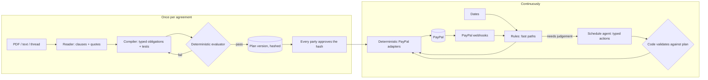

# Clausework

**Upload any agreement. Get a billing system that runs itself, on PayPal.**

Clausework reads a contract, a statement of work or a deal agreed over email, and compiles every
payment obligation in it into live PayPal billing: deposits, retainers with escalators, usage and
overage, prepaid blocks, milestone invoices, late fees, revenue shares, subcontractor splits,
retainage and service credits. Both sides approve the compiled money plan before anything goes
live. A schedule agent then keeps billing and the delivery schedule in step as things change, and
every charge links back to the clause that created it.

> Both sides sign the money, not just the words.

## The problem

Contract terms that never get billed. Escalators nobody applies on the anniversary, overage hours
nobody invoices, late fees nobody charges, royalties that need a spreadsheet, and subcontractors
who wait for someone to remember their share. Contract tools read contracts; billing tools send
bills. Nothing compiles one into the other, because that needs an AI that understands legal
language and can map it to payment building blocks, and code that can prove the mapping is right.

## What it does

| Step        | What happens                                                                                                                                                                                                      | Where the AI is, and what code checks                                                                                                                                                                                    |
| ----------- | ----------------------------------------------------------------------------------------------------------------------------------------------------------------------------------------------------------------- | ------------------------------------------------------------------------------------------------------------------------------------------------------------------------------------------------------------------------ |
| **Read**    | Upload a PDF or paste text. Clauses that carry money are highlighted in the document as they are found.                                                                                                           | The model quotes each clause. Code checks that every quote appears in the document, character for character after normalising whitespace. A quote it cannot find is flagged.                                             |
| **Compile** | Each clause becomes typed obligations in a small billing language, each with the PayPal product it runs on.                                                                                                       | The model writes tests for every obligation from the clause wording, computing the amounts itself. A deterministic evaluator runs them against the plan. Failures go back to the model for one repair, then to a person. |
| **Review**  | Anything the compiler was unsure of (below 80% confidence, or with an open question) is flagged beside its clause.                                                                                                | Nobody can approve, and nothing goes live, until the owner confirms or corrects each flagged obligation. An agreement that has already ended is offered for audit, not billing.                                          |
| **Approve** | Every party that pays or is paid gets a portal link, sees only their own lines with the clause beside each, and approves.                                                                                         | An approval binds to the plan's SHA-256 hash, so changing anything restarts the approvals. The last approval makes the plan live.                                                                                        |
| **Go live** | PayPal objects are created: an Orders authorization for the deposit, a catalog product, plan and subscription for the retainer, a Usage-Based Billing meter with an 80% alert. The payer approves them on PayPal. | Only deterministic adapters call PayPal, each with an idempotency key derived from the charge.                                                                                                                           |
| **Run**     | Rules raise what falls due: captures when work starts, anniversaries, period closes, delivered milestones, splits on receipt, retainage releases. The schedule agent handles anything that needs judgement.       | The agent picks from a fixed set of typed actions and cites a clause for each. Code checks every action against the approved plan and computes every amount. Each decision is recorded with exactly what the agent saw.  |
| **Amend**   | Paste the email thread where a change was agreed. It becomes a new plan version, shown as a diff, effective from the agreed date.                                                                                 | Only the parties whose money changes approve again. Earlier periods keep the old terms.                                                                                                                                  |
| **Audit**   | Upload last year's PayPal activity export next to the contract. Get "owed to you" and "you owe" figures with the clause behind each line.                                                                         | The model matches messy payments to expected charges. Every difference is arithmetic.                                                                                                                                    |

## Clause → PayPal

| Clause                    | Example wording                                             | PayPal                                                       | How it runs                                                                                                                                |
| ------------------------- | ----------------------------------------------------------- | ------------------------------------------------------------ | ------------------------------------------------------------------------------------------------------------------------------------------ |
| Deposit                   | "30% of the Project Fees on signing"                        | Orders v2, `AUTHORIZE`                                       | Authorized when the client approves on PayPal, captured when the phase it secures starts; reauthorized if work slips past the honor period |
| Recurring fee + escalator | "USD 3,000 per month … increases by 3% on each anniversary" | Catalog Products + Billing Plans + Subscriptions             | Plan repriced (`update-pricing-schemes`) on the anniversary                                                                                |
| Usage / overage           | "above 20 hours … USD 40 per hour"                          | Usage-Based Billing meter + alert; Invoicing for the overage | Usage events metered, 80% alert from PayPal, overage invoiced at period close                                                              |
| Prepaid block             | "100 hours for USD 15,000, then USD 175/hour"               | Invoicing                                                    | The block is invoiced on its date; hours past it are billed as usage                                                                       |
| Milestone                 | "On delivery … USD 19,200, net 30"                          | Invoicing v2                                                 | Invoiced when the phase is marked delivered; the Gantt shows the next phase blocked until paid                                             |
| Late fee                  | "1.5% … for each month or part"                             | Invoicing                                                    | Raised by the schedule agent, which checks dispute windows first                                                                           |
| Subcontractor split       | "20% of each payment … within 5 business days"              | Payouts                                                      | Paid out the moment the receipt lands                                                                                                      |
| Revenue share / royalty   | "8% of all fees … quarterly", "after recouping the advance" | Payouts                                                      | Quarterly payouts, with recoupment, and a statement line per payee                                                                         |
| Retainage                 | "withhold 10% … released 30 days after acceptance"          | Invoicing                                                    | Deducted from milestone invoices, released on the date                                                                                     |
| Service credit            | "credit 10% of that month's fee"                            | Payments refund                                              |                                                                                                                                            |

## How it uses AI

Claude (`claude-opus-5-5` through the Anthropic API, with structured outputs) reads and judges.
Deterministic code handles every amount and every PayPal call. All prompts are built on the server.

| Agent                      | What the model does                                                                                                                                                                                                                     | What code enforces                                                                                                                                                                                 |
| -------------------------- | --------------------------------------------------------------------------------------------------------------------------------------------------------------------------------------------------------------------------------------- | -------------------------------------------------------------------------------------------------------------------------------------------------------------------------------------------------- |
| Contract compiler          | Quotes every clause that involves money, then compiles the clauses into typed obligations, each with a confidence and the ambiguities it noticed. Writes tests for each obligation from the clause wording, with the amount it expects. | Each quote must appear verbatim in the source, or its clause is marked unverified and needs a person. A deterministic evaluator runs every test; a failure gets one repair, then goes to a person. |
| Schedule agent             | When something changes (a phase moves, a payment fails, a payout is unclaimed), picks actions from a fixed, typed list and cites the clause for each.                                                                                   | Every action is checked against the approved plan. Code computes the amounts. A phase can be delayed but never brought forward, and every capture or raise passes the same due test the rules use. |
| Transaction matcher        | Matches a messy PayPal activity export to the charges the contract expected (audit mode).                                                                                                                                               | The owed and overpaid totals are computed by code from the matches.                                                                                                                                |
| Amendment drafter          | Turns an email thread agreeing a change into a new plan version with an effective date.                                                                                                                                                 | Shown as a diff; only the parties whose money changes approve again.                                                                                                                               |
| Ledger analyst (AG Studio) | Answers questions about the ledger, with tools to explain a charge from its clause, remind a payer and find what is at risk.                                                                                                            | Calls are rate-limited per hour; reminders go through the same PayPal adapter as everything else.                                                                                                  |

`pnpm eval` runs the agents against the real model, including instructions planted in contract
clauses, email threads and ledger questions.

## Architecture



- `packages/core`: money (bigint minor units), the plan language, clause quote matching.
- `packages/billing`: pure and deterministic. It evaluates an obligation for a scenario, projects charges, diffs plans and computes owed versus paid.
- `packages/agents`: the contract compiler, schedule agent, transaction matcher, amendment drafter and ledger analyst, on Claude with structured outputs. Every agent puts untrusted text (contracts, threads, payment memos) in a tag it cannot close.
- `packages/paypal`: `PayPalGateway`, with a REST client for sandbox and live, and a simulator that mirrors the sandbox for tests.
- `packages/engine`: services, durable workflows on [DBOS](https://dbos.dev), activation, rules, the agent gateway, webhooks and reconciliation with PayPal, audit, owner access and alerts.
- `apps/api`: Hono API. `apps/web`: Next.js product UI with AG Grid / AG Studio and the Bryntum Gantt.

### Durable by design

Everything with an outside effect runs as a DBOS workflow recorded in Postgres, so a restart
resumes it at the step it stopped on instead of losing or repeating work:

| Workflow           | Steps                                                                     | Runs                                      |
| ------------------ | ------------------------------------------------------------------------- | ----------------------------------------- |
| `compileAgreement` | read, compile, each repair (model calls checkpointed), save               | on upload                                 |
| `setUpPayPal`      | one per obligation: order, product + plan + subscription, meter           | on the last approval                      |
| `handleWebhook`    | handle the event, then that day's rules                                   | per PayPal event                          |
| `rulesForDay`      | the agreement's rules for one day                                         | hourly, once per agreement and day        |
| `checkWithPayPal`  | ask PayPal about deposits, subscriptions, invoices and payouts still open | every 2 minutes, and when a payer returns |
| `alertOwner`       | post what needs the owner to a webhook, in order, each once               | every 2 minutes                           |
| `auditAgreement`   | match last year's history (model call checkpointed)                       | on request                                |

Work on one agreement runs on a queue partitioned by agreement, one workflow at a time across
every server, and people's edits take the same agreement's Postgres advisory lock. Workflow ids
are deterministic, so queueing the same day's rules or the same webhook twice is a no-op.

## Run it

Requires Node 24, Docker, an Anthropic API key and a PayPal sandbox app (see
[PayPal sandbox](#paypal-sandbox) for its keys).

```sh
corepack enable               # provides the pnpm version pinned in package.json
pnpm install
cp .env.example .env && chmod 600 .env
# A random database password, written into POSTGRES_PASSWORD and both database URLs:
pw=$(openssl rand -hex 24) && sed -i.bak "s/^POSTGRES_PASSWORD=$/POSTGRES_PASSWORD=$pw/; s/<POSTGRES_PASSWORD>/$pw/g" .env && rm .env.bak
```

Put `ANTHROPIC_API_KEY`, `PAYPAL_CLIENT_ID` and `PAYPAL_CLIENT_SECRET` in `.env` (each setting is
explained in `.env.example`), then:

```sh
pnpm db:up                    # Postgres 17 on :5434, credentials from .env
pnpm dev                      # API :4100 (runs migrations on start), web :3000
```

On first start the API prints the **owner key** once. Sign in with it at <http://localhost:3000>.
Only its hash is kept; `pnpm owner-key:reset` issues a new one. Parties to an agreement never need
it: each gets a portal link that reaches only their own lines.

Upload a contract or pick a sample. To load all three samples at once:

```sh
CLAUSEWORK_OWNER_KEY=cw_… pnpm seed:demo
```

### PayPal sandbox

1. Sign in at developer.paypal.com with any PayPal account (or create a free personal one). Sandbox
   work never touches real money, and the account's country does not limit what the sandbox can do.
2. Testing Tools → Sandbox Accounts → Create account: a **Business** account in the **United
   States**. PayPal also creates a personal (buyer) account; use its email and password, from View/Edit
   account, to pay at checkout, in a private window so it does not clash with a real PayPal login.
3. Apps & Credentials → Sandbox → Create App, owned by that US business account, with Invoicing,
   Subscriptions, Payouts and Transaction Search enabled.
4. Put the app's client ID and secret in `.env` as `PAYPAL_CLIENT_ID` and `PAYPAL_CLIENT_SECRET`.
5. Webhooks need the app at a public HTTPS address. Once it has one (see [Hosting](#hosting)), run
   `pnpm webhook:register https://<your domain>`: it subscribes the app's webhook to the events
   Clausework handles and saves `PAYPAL_WEBHOOK_ID` to `.env`. Restart the API. Without webhooks,
   for example on a laptop, the PayPal check that runs every two minutes still picks up payments.
6. Payouts need available balance in the sandbox business account; payments it has just received can
   take a while to become available. A refused payout is shown in Activity and retried with backoff
   (5 minutes, doubling, at most 6 hours).
7. Usage-Based Billing is in limited release. When `/v1/commerce/billing/activate` refuses, usage is
   invoiced at period close instead, and the UI says so.

### Alerts

Set `CLAUSEWORK_ALERT_WEBHOOK_URL` (a Slack incoming webhook works as is) to be told when something
needs you: an escalation from the agent, a payment PayPal refused or failed, an unclaimed or returned
payout, a phase held by a late payment, a failed compile, or an amendment awaiting approval.

### Recording a demo

Record from a production build, which has no development overlay:

```sh
pnpm --filter @clausework/web build
pnpm --filter @clausework/web exec next start -p 3000   # with the API running on :4100
```

### Hosting

Docker Compose runs the whole stack (`Dockerfile`, `docker-compose.yml`): Postgres, the API and the
web app, each published on loopback only, behind your own HTTPS reverse proxy. The host needs only
Docker with the Compose and Buildx plugins, about 3 GB of memory for the web build, and a domain.

1. Clone the repo and create `.env` with the `cp` and password commands from [Run it](#run-it).
   Then set:
   - `ANTHROPIC_API_KEY`, `PAYPAL_CLIENT_ID`, `PAYPAL_CLIENT_SECRET` and `PAYPAL_MODE` (`sandbox`
     or `live`)
   - `CLAUSEWORK_PUBLIC_URL=https://<your domain>`, the address people open the app at; portal and
     PayPal return links are built from it
   - recommended: `CLAUSEWORK_OWNER_KEY=cw_<random>` (e.g. from `openssl rand -hex 24`), so no key
     is printed to the logs
   - recommended: `CLAUSEWORK_TIMEZONE`, your business's IANA time zone (e.g. `America/New_York`).
     Contract dates are calendar days; this decides when each one starts. Defaults to UTC.
   - optional: `CLAUSEWORK_ALERT_WEBHOOK_URL`, and the `NEXT_PUBLIC_*` licence keys, which are built
     into the web image
2. Start everything; the API runs its migrations and resumes any interrupted workflow:

   ```sh
   docker compose --profile app up -d --build --wait
   ```

3. Point your reverse proxy at it:
   - `/api/webhooks/paypal` → `127.0.0.1:4100`, so PayPal's signed body reaches the API untouched
   - everything else → `127.0.0.1:3000` (the web app proxies the rest of `/api/*`)
   - allow request bodies up to about 31 MB, send `Strict-Transport-Security`, and pass
     `X-Forwarded-Host` through

   A proxy that runs in Docker can join the `clausework_default` network and use `api:4100` and
   `web:3000` instead.
4. Register the PayPal webhook (writes `PAYPAL_WEBHOOK_ID` into `.env`), then recreate the API:

   ```sh
   docker compose run --rm --no-deps -v "$PWD/.env:/app/.env" api tsx src/register-webhook.ts https://<your domain>
   docker compose --profile app up -d api
   ```

Day to day:

```sh
docker compose logs -f api                              # without CLAUSEWORK_OWNER_KEY, the first start prints the owner key here
docker compose exec api tsx scripts/seed.ts             # load the sample agreements (needs CLAUSEWORK_OWNER_KEY)
docker compose exec api tsx src/reset-owner-key.ts      # new owner key, ending every session (when it is not set in .env)
git pull && docker compose --profile app up -d --build --wait && docker image prune -f   # update
```

The containers run as a non-root user with read-only filesystems and no Linux capabilities, restart
on failure, and have health checks (`GET /api/health`; `GET /api/ready` is 503 while the database is
down). Routes that call the model are limited per hour; also set a spend limit on the Anthropic key.

## Tests and evals

```sh
pnpm test        # billing, agents (offline), PayPal adapters, engine and workflows on real Postgres + DBOS, API
pnpm test:live   # the PayPal client against the real sandbox
pnpm eval        # the agents against the real model: compiles, judgement, matching, amendments, ledger, injection
pnpm typecheck
pnpm lint
```

The engine tests drive whole agreements through approval, deposit authorization and capture,
subscription cycles, delivered milestones with retainage, subcontractor payouts, usage overage,
overdue invoices, gating payments and effective-dated amendments, on the PayPal simulator with
scripted agents, so every run is deterministic. The workflow tests check that the schedule runs
each agreement's day once, that a lost webhook is recovered by the PayPal check, that stuck work is
swept up, that lanes exclude each other across connection pools, and that alerts are delivered
once each. CI (`.github/workflows/ci.yml`) runs lint, types, a dependency audit, tests and the web
build, and builds both Docker images.

## Honest limits

- One workspace with one owner. The owner signs in with the owner key; parties reach only their own
  lines through unguessable portal links (an HMAC of the agreement and party). There are no
  separate user accounts or roles.
- Legal advice is out of scope. Clausework bills what both parties approved.
- Automatic recovery only works for money that moved through Clausework. For outside payments, the
  audit produces a claim with the clause, the expected amount and the actual charge.
- When you pay others (advances, subcontractor shares, royalties), Clausework pays through Payouts
  from your PayPal account; what two other parties owe each other is tracked, not moved.
- Usage-Based Billing request shapes for charges follow the published spec but have not been run
  against an enabled account.

## Built with

- **PayPal:** Orders v2 (authorize and capture), Catalog Products, Billing Plans and Subscriptions,
  Invoicing v2, Payouts, Transaction Search and Webhooks, all run against the sandbox. Usage-Based
  Billing is wired in for accounts with the limited release.
- **AI:** Claude Opus 5.5 through the Anthropic API.
- **Sponsor tools:**
  - [AG Grid](https://www.ag-grid.com) Enterprise and AG Studio:
    - the ledger of every charge, with row grouping, set filters and integrated charts;
    - a master/detail trace on each charge: the clause it comes from (verbatim), the tests that prove its amount, the agent's decisions and the PayPal money that moved;
    - an Excel export with clause citations;
    - a cash forecast with bar sparklines per agreement and a pivot by month;
    - an AG Studio assistant on the Agent Framework, which explains charges, finds risk and reminds payers.
  - The [Bryntum Gantt](https://bryntum.com/products/gantt/): delivery phases with payments as dependencies.
- **App:** TypeScript on Node 24, pnpm and Turborepo, Hono, Next.js 16, PostgreSQL 17, Drizzle,
  [DBOS](https://dbos.dev) durable workflows, Zod, Vitest and Biome.
- **Hosting:** Docker Compose behind Caddy on AWS EC2, with Cloudflare in front and GitHub Actions
  for CI.

## License

[MIT](LICENSE)
